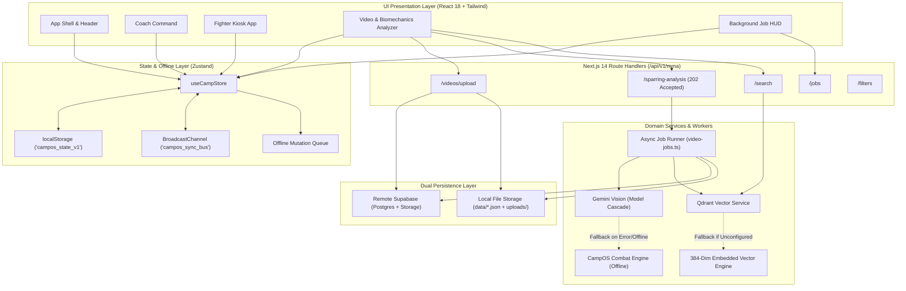

# Architecture — CampOS

## Tech Stack

| Layer | Technology | Version | Purpose |
| :--- | :--- | :--- | :--- |
| **Framework** | Next.js (App Router) | `14.2.15` | Core full-stack web application framework, SSR/SSG & Route Handlers |
| **Language** | TypeScript | `^5.6.3` | Strict static typing across models, state, and API contracts |
| **UI Library** | React | `^18.3.1` | Component model, Client Components, and hooks |
| **Styling** | Tailwind CSS | `^3.4.14` | Utility-first styling with athletic dark theme extensions |
| **CSS Preprocessor**| PostCSS + Autoprefixer | `^8.4.47` / `^10.4.20`| Cross-browser CSS transformations |
| **State Management**| Zustand | `^4.5.5` | Global application store, localStorage persistence & BroadcastChannel sync |
| **Data Visualization**| Recharts | `^2.13.0` | Interactive SVG charting for weight cuts and readiness analytics |
| **Icons** | Lucide React | `^0.453.0` | Athletic and interface iconography |
| **AI / Multimodal** | Google Generative AI | `^0.24.1` | Gemini multimodal video frame analysis & tactical fight IQ generation |
| **Vector Database** | Qdrant JS Client | `^1.19.0` | 384-dimensional dense semantic vector storage and similarity search |
| **Relational / Storage**| Supabase JS | `^2.45.6` | Remote cloud PostgreSQL, RLS policies, and video object storage |
| **Local Persistence**| Node.js `fs` / Web Storage | Built-in | Local-first JSON file fallback (`data/`) and browser localStorage |

---

## Complete Folder Structure

```
c:/dev/New CampOS/
├── app/
│   ├── layout.tsx                    # Root layout with PWA registration & BackgroundJobHUD
│   ├── page.tsx                      # Main multi-role app shell (Coach / Fighter / Analyzer)
│   ├── globals.css                   # Tailwind directives, combat glow classes & custom scrollbars
│   ├── analyzer/
│   │   └── page.tsx                  # Dedicated deep-link to MMA Video & Biomechanics Analyzer
│   ├── fighter/
│   │   └── page.tsx                  # Dedicated deep-link to Fighter App / Kiosk
│   └── api/
│       └── v1/
│           └── mma/
│               ├── filters/
│               │   └── route.ts      # Taxonomy filter values (disciplines, movement types, biomechanics)
│               ├── jobs/
│               │   └── route.ts      # Active/completed analysis jobs polling & query endpoint
│               ├── search/
│               │   └── route.ts      # 384-dim semantic similarity search for techniques & insights
│               ├── sparring-analysis/
│               │   └── route.ts      # Asynchronous analysis job dispatcher (returns 202 Accepted)
│               └── videos/
│                   ├── route.ts      # Video metadata query & filter endpoint
│                   └── upload/
│                       └── route.ts  # Video file upload handler (Supabase Storage / local filesystem)
├── components/
│   ├── analyzer/
│   │   ├── BackgroundJobHUD.tsx      # Floating status HUD for asynchronous video processing
│   │   ├── BiomechanicalInspector.tsx# Joint angles, angular velocities & injury risk assessment
│   │   ├── MMAVideoAnalyzer.tsx      # Main analyzer dashboard, search filters & debrief panels
│   │   ├── SparringVideoUploader.tsx # Footage upload modal with HTML5 canvas frame extraction
│   │   └── VideoPlayerPanel.tsx      # Scrubbable player with step controls and playback rates
│   ├── coach/
│   │   ├── CoachDashboard.tsx        # High-level coach hub coordinating roster, chart & planner
│   │   ├── CutSheetModal.tsx         # Day-by-day fight week hydration & sodium protocol sheet
│   │   ├── ReadinessOverview.tsx     # Team readiness matrix, sleep & body soreness summaries
│   │   ├── RosterSidebar.tsx         # Fighter selection, camp countdowns & health badges
│   │   ├── TrainingSchedulePlanner.tsx# Weekly schedule by discipline with target RPEs
│   │   ├── WeighInModal.tsx          # Rapid morning/evening scale entry modal
│   │   └── WeightCutChart.tsx        # Interactive Recharts area chart with danger zone thresholds
│   ├── fighter/
│   │   ├── CheckInModal.tsx          # Morning check-in with interactive 15-zone body map
│   │   ├── FighterApp.tsx            # Fighter role root coordinating PIN login and home view
│   │   ├── FighterHome.tsx           # Athlete readiness dashboard & next session preview
│   │   ├── HydrationTracker.tsx      # Quick fluid addition & 5-stage urine color scale
│   │   ├── PinLogin.tsx              # 4-digit numeric keypad shared kiosk authentication
│   │   └── WorkoutChecklist.tsx      # Session round checklists, timer & post-workout RPE
│   └── ui/
│       ├── Header.tsx                # Sticky top bar with role switcher, unit toggle & sync status
│       └── PwaRegister.tsx           # Client-side Service Worker registration for PWA installation
├── context/                          # Project specifications, rules, tokens, and standards
├── data/                             # Local JSON persistence directory (offline fallbacks)
│   ├── analysis_jobs.json            # Persistent store for background video analysis jobs
│   └── uploaded_videos.json          # Persistent store for uploaded video records
├── lib/
│   ├── ai/
│   │   ├── gemini-service.ts         # Google Gemini integration with candidate model cascade
│   │   ├── sparring-analyzer.ts      # CampOS Combat Engine rule-based offline analysis fallback
│   │   └── video-jobs.ts             # Background asynchronous job queue and worker runner
│   ├── db/
│   │   └── video-db.ts               # Video metadata CRUD with dual Supabase/local file adapter
│   ├── vector/
│   │   ├── embeddings.ts             # Deterministic 384-dim semantic embedding generator & cosine sim
│   │   └── qdrant-service.ts         # Qdrant client, collection schemas & in-memory vector fallback
│   ├── mock-data.ts                  # Seed fighters, check-ins, hydration, and cut protocols
│   ├── store.ts                      # Core Zustand state store with localStorage & BroadcastChannel
│   ├── supabase.ts                   # Supabase client initializer and relational persistence
│   └── utils.ts                      # Unit conversions (lbs/kg, oz/gal) and date helpers
├── public/
│   ├── manifest.json                 # PWA Web App Manifest
│   └── sw.js                         # Service Worker script
├── supabase/
│   └── migrations/                   # PostgreSQL schema migrations
│       └── 20260903_create_uploaded_videos.sql
├── types/
│   ├── camp.ts                       # Core domain models (Fighter, CheckIn, Hydration, TrainingSession)
│   ├── sparring-analysis.ts          # Video analysis contracts (TacticalSequence, BiomechanicalMetric)
│   └── video-search.ts               # Vector search & technique taxonomy interfaces
├── next.config.mjs                   # Next.js build configuration
├── package.json                      # NPM dependencies & scripts
├── tailwind.config.ts                # Tailwind custom theme extensions (combat palette, glow effects)
└── tsconfig.json                     # TypeScript strict configuration
```

---

## Architectural Layers



---

## Key Subsystems

### 1. Local-First Gym Floor Synchronization
Combat gym environments cannot rely on 100% cloud uptime. CampOS implements a layered resilience strategy:
- **Zustand Store (`lib/store.ts`)**: Serves as the central state hub. On initial client mount, `rehydrateFromStorage()` synchronizes the state from `localStorage` (`campos_state_v1`).
- **BroadcastChannel (`campos_sync_bus`)**: When multiple tabs or gym tablet kiosks are active simultaneously on the local network, mutations (e.g. logging a weigh-in, completing a workout round) are broadcast instantly across all active tabs without waiting for remote server roundtrips.
- **Offline Mutation Queue (`offlineQueue`)**: If network connectivity drops (`navigator.onLine === false`), actions are tagged with timestamps and queued locally. Once `window.addEventListener('online')` fires, `syncOfflineQueue()` pushes pending items.

### 2. Asynchronous Video Processing & Telemetry Pipeline
Video analysis requires heavy AI inference and cannot freeze the user experience:
1. **Client Frame Extraction**: `SparringVideoUploader.tsx` extracts key video frames using an HTML5 `<canvas>` element at 1-2 frames per second, converting frames to base64 payloads.
2. **202 Accepted Response**: `POST /api/v1/mma/sparring-analysis` validates the payload, enqueues the job via `createAnalysisJob()`, triggers `runBackgroundAnalysis()` in the background worker, and immediately returns HTTP `202 Accepted` with a `jobId`.
3. **Floating Background HUD**: `BackgroundJobHUD.tsx` monitors active background jobs, polling `/api/v1/mma/jobs` and displaying real-time progress through 6 stages:
   - `queued` (0%)
   - `extracting_telemetry` (20%)
   - `gemini_vision` (45%)
   - `persisting_database` (70%)
   - `vector_indexing` (90%)
   - `completed` (100%)
4. **State Re-injection**: Upon completion, the result is saved to disk (`data/analysis_jobs.json`) and store state, allowing the coach to immediately review the video with overlay telemetry.

### 3. AI Vision Model Cascade & Rule-Based Fallback
To ensure high availability and prevent 503 high-demand rate limit failures from AI APIs:
- **Model Cascade**: `lib/ai/gemini-service.ts` attempts Gemini models in cascading order:
  1. `gemini-3.5-flash`
  2. `gemini-flash-latest`
  3. `gemini-3.6-flash`
  4. `gemini-3.8-flash`
- **Offline Combat Engine Fallback**: If `GEMINI_API_KEY` is not provided or the remote API is unreachable, the system automatically falls back to `lib/ai/sparring-analyzer.ts`. This internal engine evaluates sparring metadata, duration, and round numbers using domain combat sports rules to generate structured grades, tactical sequences, biomechanical flaw detections, and prescribed action drills.

### 4. 384-Dimensional Semantic Vector Search
- **Taxonomy & Embeddings**: `lib/vector/embeddings.ts` implements a deterministic 384-dimensional dense semantic embedding engine with a built-in combat sports taxonomy covering Grappling/Takedowns, Submissions/Counters, Striking, and Biomechanical/Posture concepts.
- **Qdrant Vector Layer**: `lib/vector/qdrant-service.ts` interfaces with Qdrant Cloud collections (`mma_technical_framework` and `sparring_insights`).
- **In-Memory Cosine Fallback**: If `QDRANT_URL` or `QDRANT_API_KEY` are unset, CampOS automatically runs its high-performance in-memory vector cosine similarity engine over seeded technical slices and historical sparring debriefs.

### 5. Dual Persistence Adapter (Supabase + Local Filesystem)
- **Remote Cloud (Supabase)**: When configured via `NEXT_PUBLIC_SUPABASE_URL` and `NEXT_PUBLIC_SUPABASE_ANON_KEY`, videos are uploaded to the `sparring-videos` bucket, and sessions are upserted into `sparring_sessions`, `sparring_insights`, and `sparring_sequences`.
- **Local Fallback**: If Supabase credentials are not provided, files are written directly to `public/uploads/videos/` and metadata is recorded in `data/uploaded_videos.json`.

---

## API Route Specifications

| Route | Method | Payload / Query | Response | Status |
| :--- | :--- | :--- | :--- | :--- |
| `/api/v1/mma/videos/upload` | `POST` | `multipart/form-data` (`file`, `fighterId`, `roundNumber`, `partnerStyle`, `intensity`, `durationSeconds`) | `{ success, record: UploadedVideoRecord }` | `200` / `400` / `500` |
| `/api/v1/mma/videos` | `GET` | `?fighterId=f1` | `{ count, videos: UploadedVideoRecord[] }` | `200` |
| `/api/v1/mma/sparring-analysis` | `POST` | `application/json` (`metadata`, `duration`, `frames[]`) | `{ success, message, jobId, job }` | `202 Accepted` |
| `/api/v1/mma/jobs` | `GET` | `?jobId=xxx` or none | `{ activeJobs, completedJobs }` or single job | `200` / `404` |
| `/api/v1/mma/search` | `POST` | `application/json` (`query_text`, `discipline`, `stance`, `min_confidence`, `max_posture_angle`, `limit`) | `{ results, insightMatches, total_matches, latency_ms, fallback_applied }` | `200` / `400` / `500` |
| `/api/v1/mma/filters` | `GET` | None | `{ disciplines, movementTypes, stances, techniqueNames, biomechanicalRanges }` | `200` |
